<p align="center"></p>

<h1 align="center">Reading Stars</h1>
<p align="center"><b>Read. Match. Shine.</b><br><sub>Skaitymo žvaigždės · Estrellas lectoras</sub></p>

A picture-and-word reading game for kids, built as a single [Scriptable](https://scriptable.app) script for iPhone and iPad. Kids earn tokens for reading correctly, and parents can exchange those tokens for real pocket money from a budget the kids never see.

<table>
<tr>
<td>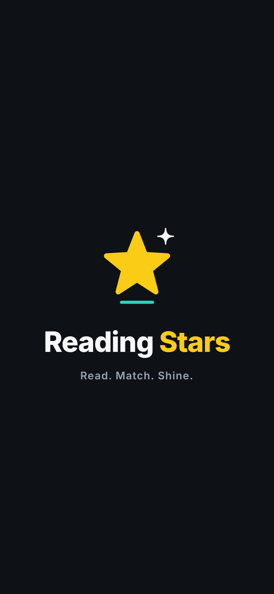</td>
<td></td>
<td>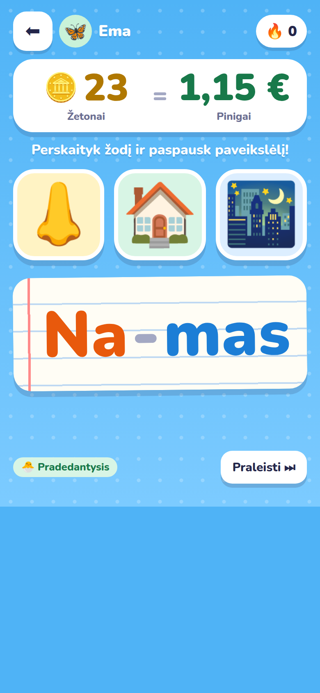</td>
<td>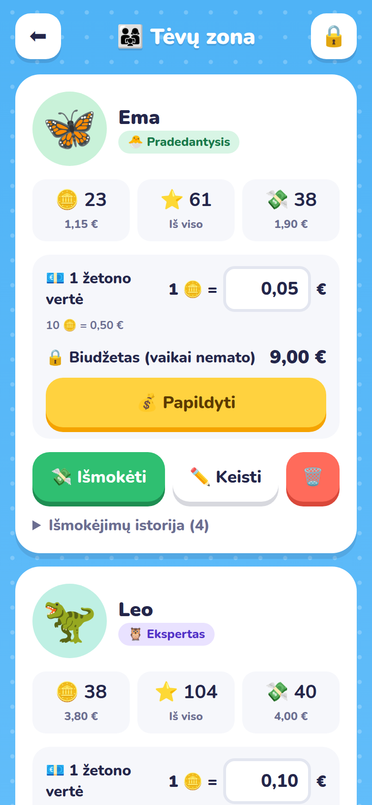</td>
</tr>
<tr>
<td align="center"><sub>Opens on its star</sub></td>
<td align="center"><sub>Pick a player</sub></td>
<td align="center"><sub>Read the word, tap the picture</sub></td>
<td align="center"><sub>Parent zone: value, budget, payout</sub></td>
</tr>
</table>

## Install

1. Get **[Scriptable](https://apps.apple.com/app/scriptable/id1405459188)** (free) from the App Store.
2. In Scriptable tap **+**, paste this line and tap **▶︎**:
   ```js
   const s = await new Request("https://raw.githubusercontent.com/gadominas/Reading-Stars/main/install.js").loadString(); await Function("module", "return (async () => {" + s + "\n})()")(module);
   ```
3. Tap **Open now**. That's it: *Reading Stars* is in your scripts list.

- **Updates:** from v1.1.0 the game offers new versions itself (see below). On an older copy, run the install line once more.
- **Home Screen icon:** in Scriptable tap *⋯* on *Reading Stars* → *Add to Home Screen*.
- **Manual install:** create a new script and paste the whole [`Reading Stars.js`](Reading%20Stars.js) instead.

## Updates and what's new

When a new version is out, the home screen shows what it brings, with **Update now** and **Later** (asks again in 2 days). The offer never interrupts a round, and updating keeps all players, tokens, budgets and the PIN. Close and reopen the game afterwards.

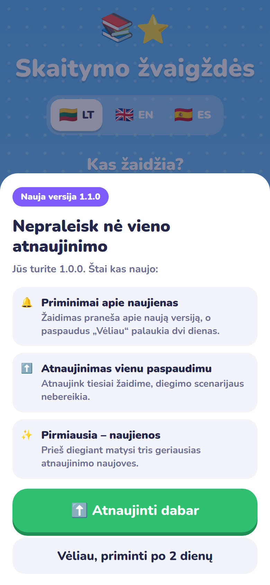

Every version is listed in [CHANGELOG.md](CHANGELOG.md). To publish one, follow [docs/RELEASING.md](docs/RELEASING.md). To turn the checks off, switch off **Parent zone › Settings › Updates › Offer new versions**; **Check for updates now** checks at once.

## Launch screen

Reading Stars opens on its logo for 2.4 seconds: the star traces its outline and pops in, the sparkle and the reading line follow, then "Read. Match. Shine." (*Skaityk. Rask. Spindėk.*, *Lee. Elige. Brilla.* in the game's language). Tap to skip; with Reduce Motion it appears without movement. It is the shared [launch-screen](https://github.com/gadominas/app-blueprints/blob/main/blueprints/launch-screen.md) blueprint, so all the apps start the same way. The same star sits on top of the home screen, and [docs/icon-1024.png](docs/icon-1024.png) is the 1024 px icon for a Home Screen shortcut.

## How a round works

A word is shown big, split into syllables with dashes and a different colour per syllable: **Na-mas**, **Kar-vė**, **He-li-cop-ter**. Above it are pictures, and the kid taps the one that matches.

Every picture in a round **starts with the same letter as the word**. For *Na-mas* the choices are *namas*, *nosis* and *naktis*, so the kid can't guess from the first letter and has to read the whole word.

| Level | Ages | Word length | Pictures |
|---|---|---|---|
| 🐣 Beginner | 4–6 | 1–2 syllables | 3 |
| 🦉 Expert | 9–11 | 3–6 syllables | 5 |

| What happens | Tokens | Leaderboard |
|---|---|---|
| Correct on the first try | **+1 🪙** | +1 ⭐ |
| Each wrong tap | **−1 🪙** (never below 0) | −1 ⭐ |
| Correct after a mistake | 0 | 0 |
| Skip | 0 | 0 |

<table>
<tr>
<td></td>
<td>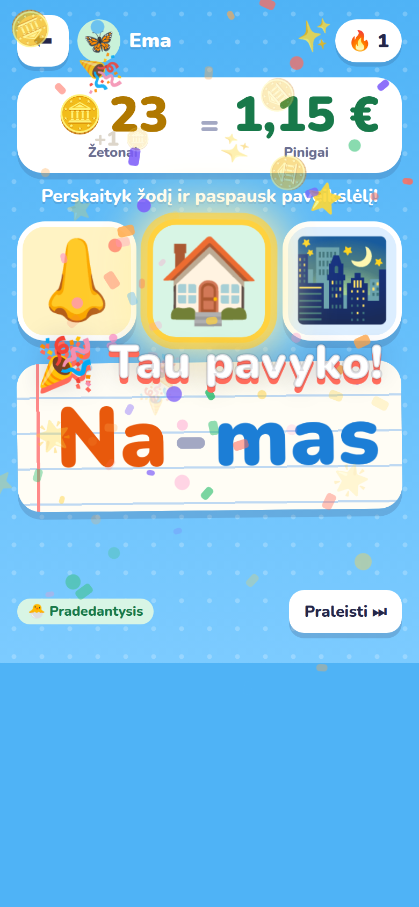</td>
<td>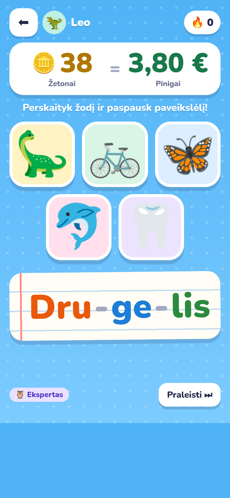</td>
<td>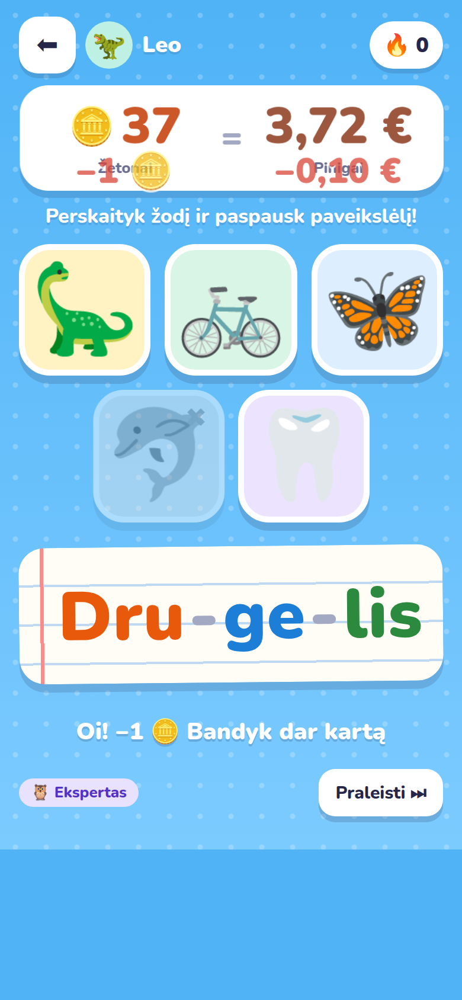</td>
</tr>
<tr>
<td align="center"><sub>Beginner: 3 pictures, all with N</sub></td>
<td align="center"><sub>Correct: confetti, cheer, a coin flies to the wallet</sub></td>
<td align="center"><sub>Expert: 5 pictures, all with D</sub></td>
<td align="center"><sub>Wrong tap: −1 🪙 and −0,10 € drop away</sub></td>
</tr>
</table>

The big wallet at the top always shows the kid's tokens and what they are worth. When it changes, the numbers count up or down, the panel pulses green or shakes red, and the difference floats over it (*+0,05 €*, *−1 🪙*).

## Tested at home

These are photos from the first evenings of play.

<table>
<tr>
<td></td>
<td></td>
</tr>
<tr>
<td><b>Bró-co-li, Expert, Spanish.</b> Five pictures that all start with B: ballena, brócoli, bañera, bicicleta, búho. A correct first try sets off confetti and <i>¡Genial!</i>, and the coin flies into the wallet: 38 fichas = 1,90 €.</td>
<td><b>A-be-ja, Expert, Spanish.</b> Every picture starts with A, so a quick guess goes wrong. The greyed-out picture was the wrong tap: <i>¡Uy! −1 🪙</i>, the wallet drops to 37 fichas = 1,85 € and a red <i>−0,05 €</i> floats away.</td>
</tr>
<tr>
<td></td>
<td></td>
</tr>
<tr>
<td><b>Ma-ri-qui-ta, Expert, Spanish.</b> Mariposa, maíz, mariquita, motocicleta, martillo: the ladybug glows gold as the correct answer. A streak of 🔥 6 first-try answers, worth 0,30 € so far.</td>
<td><b>Cir-kas, Beginner, Lithuanian.</b> Three C-words: cilindras, citrina, cirkas. The lemon was tapped by mistake and greyed out. This was an earlier build with a small token badge; the big wallet came after this first test.</td>
</tr>
</table>

## Tokens, money, budget and payouts

The game separates three things: **tokens** the kid earns, **money** those tokens are worth, and a **budget** that only the parent sees.

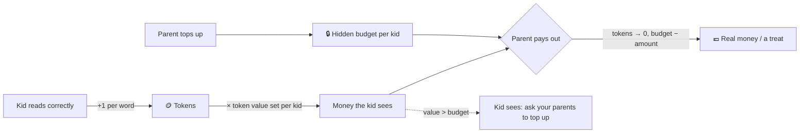

**1. Token value, per kid.** In the parent zone each kid gets their own rate, e.g. *1 🪙 = 0,05 €* for a younger kid and *1 🪙 = 0,10 €* for an older one. The kid sees the result in big numbers: *🪙 23 = 1,15 €*. Leave it at 0 and that kid only plays for tokens.

**2. Hidden budget, per kid.** The parent decides how much money is set aside for each kid and tops it up whenever they like, with quick +5 / +10 / +20 / +50 buttons or a typed amount. Kids never see the budget.

**3. Running low.** If a kid's tokens are worth more than their budget, the kid is told *"Not enough money left to exchange your tokens. Ask your parents to top up! 💰"*. The message pops up when the game starts and the moment it happens during play, and stays on the wallet and on their player card. Tokens keep counting, so nothing earned is lost.

**4. Payout.** When the kid asks to exchange, the parent opens the parent zone and taps *Pay out*. The tokens are converted into money, the money is taken from that kid's budget, and the payout is logged with the date. If the budget only covers part of the tokens, it pays what it can and the rest of the tokens stay. **Leaderboard points never go down on a payout**, so all-time progress is kept.

### Worked example

| | Ema | Ona |
|---|---|---|
| Token value | 0,05 € | 0,05 € |
| Tokens | 23 | 14 |
| Worth (what the kid sees) | 1,15 € | 0,70 € |
| Hidden budget | 9,00 € | 0,40 € |
| Kid is told to ask for a top-up | no | **yes** |
| Payout | 23 🪙 → 1,15 € | 8 🪙 → 0,40 € (6 🪙 stay) |
| Budget after | 7,85 € | 0,00 € |

<table>
<tr>
<td>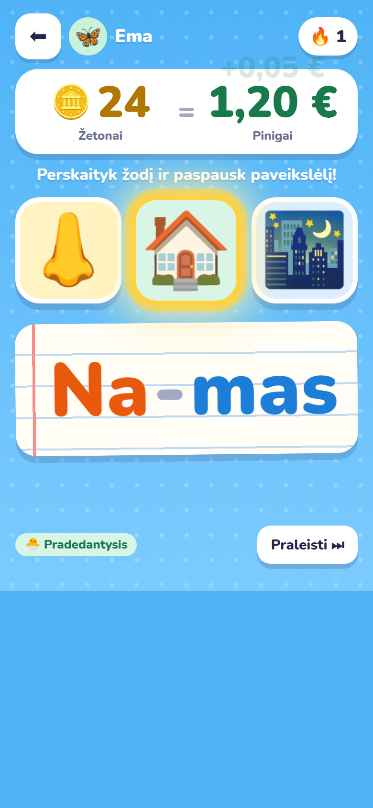</td>
<td>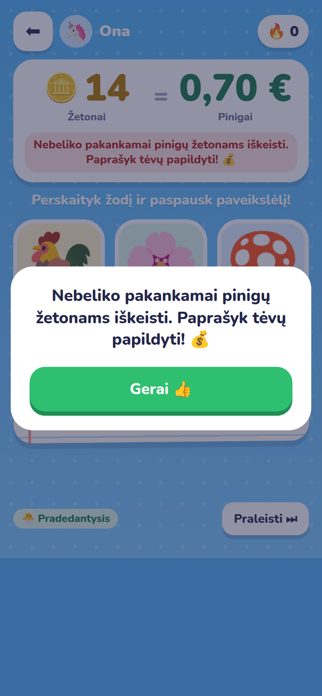</td>
<td>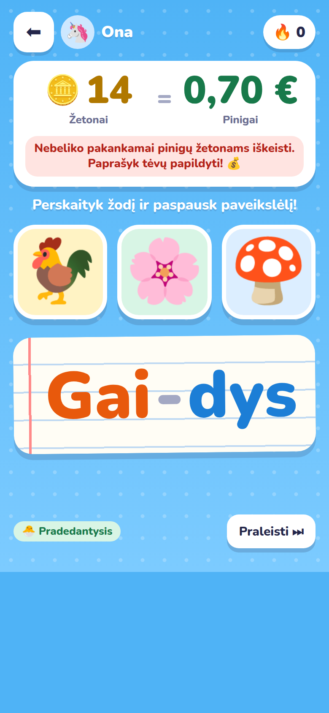</td>
<td></td>
</tr>
<tr>
<td align="center"><sub>Wallet counts up: 24 🪙 = 1,20 €</sub></td>
<td align="center"><sub>Budget too low: the kid is asked to get a top-up</sub></td>
<td align="center"><sub>The reminder stays on the wallet</sub></td>
<td align="center"><sub>Player cards show tokens, points and money</sub></td>
</tr>
</table>

## Parent zone

Protected by a 4-digit PIN (5 wrong tries lock it for a minute). For each kid:

- token balance with its money value, all-time points, and total paid out
- token value (*1 🪙 = …*) and the hidden budget, with a top-up button
- *Pay out*, *Edit* (name, level, avatar) and *Delete*
- a history of payouts and top-ups with dates

**Settings** (sliders icon in the parent zone, so only parents can reach it), in the game's language:

- **Appearance:** six colour palettes plus Auto (the bright look is the default; Night and Slate give a night sky), Comfortable, Compact or Tiny layout (one line per player on the leaderboard and in the parent zone), text size and headline font. The game screen looks the same in every layout.
- **Game:** word letter style (*Na-mas*, *NA-MAS*, *na-mas*) and sounds. **Money:** currency (EUR, USD, GBP). **Parent:** change PIN.
- **Updates:** offer new versions, and check now. **Rounds:** pictures per round for Beginner (2–4) and Expert (3–5), with Reset.
- **Built with:** the [shared blueprints](https://github.com/gadominas/app-blueprints) the app follows (see [docs/BLUEPRINTS.md](docs/BLUEPRINTS.md)).

<table>
<tr>
<td>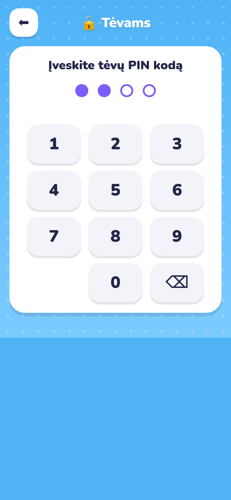</td>
<td></td>
<td>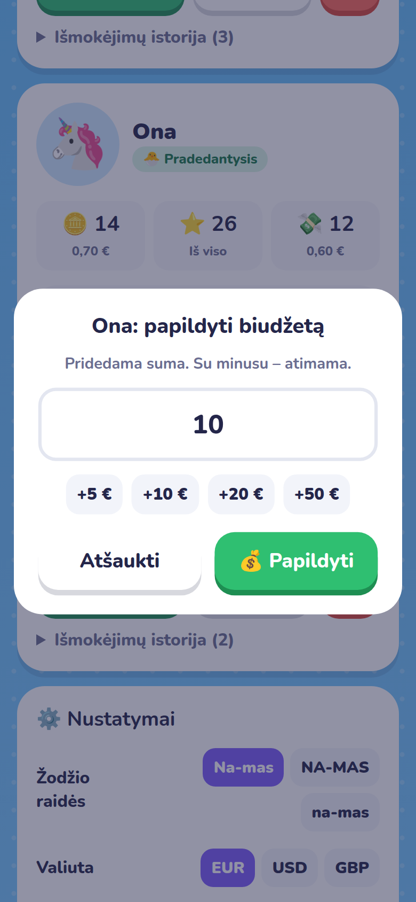</td>
<td>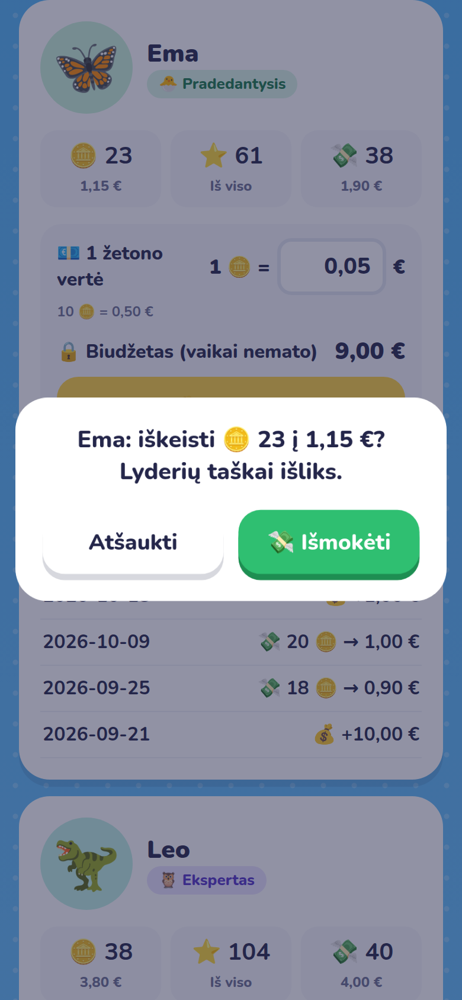</td>
</tr>
<tr>
<td align="center"><sub>Parent PIN</sub></td>
<td align="center"><sub>Value, budget, top-up, payout per kid</sub></td>
<td align="center"><sub>Top up a kid's budget</sub></td>
<td align="center"><sub>Confirm a payout: 23 🪙 → 1,15 €</sub></td>
</tr>
</table>

## Leaderboard and languages

The leaderboard ranks kids by all-time points with a podium for the top three, and also shows each kid's current tokens. Payouts never lower it.

The game speaks **Lithuanian 🇱🇹, English 🇬🇧 and Spanish 🇪🇸**, with about 190–200 picture words in each. The language switch on the home screen changes both the menus and the words.

<table>
<tr>
<td>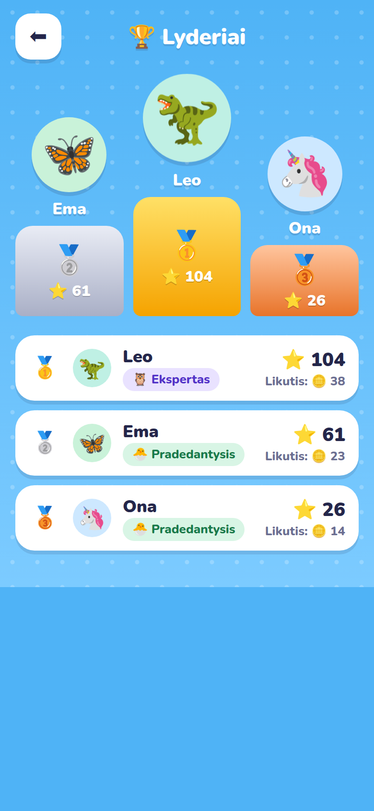</td>
<td>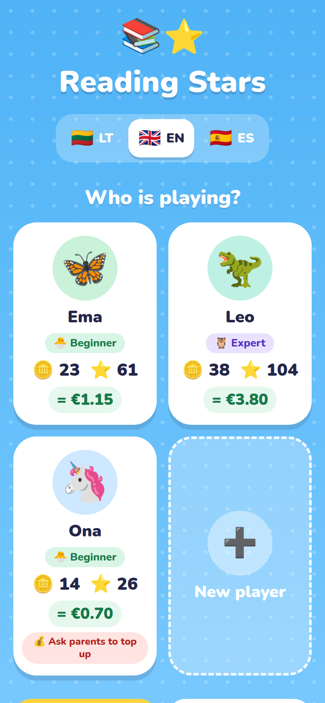</td>
<td>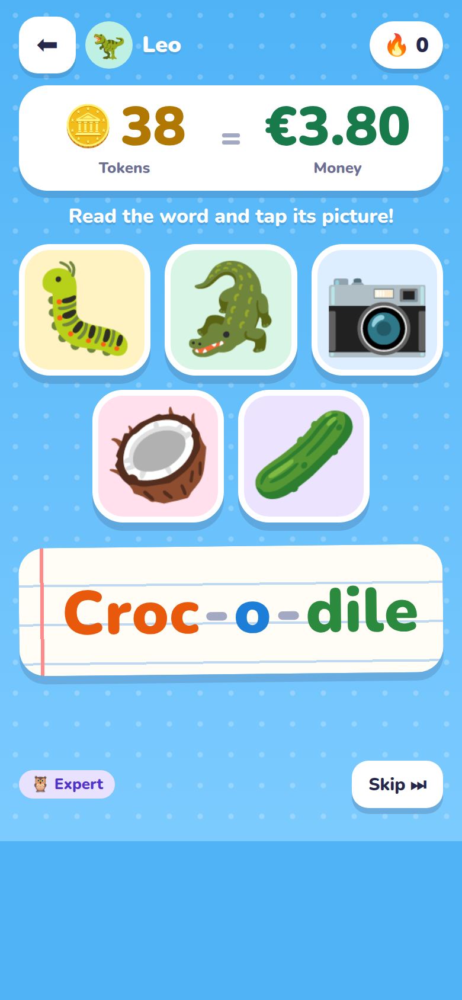</td>
</tr>
<tr>
<td align="center"><sub>Leaderboard</sub></td>
<td align="center"><sub>English home screen</sub></td>
<td align="center"><sub>Expert in English: five C-words</sub></td>
</tr>
</table>

## Data

Progress is saved to `iCloud Drive › Scriptable › ReadingStars › data.json`, with `data.backup.json` and the parent's choices (`settings.json`) next to it, or to local Scriptable storage if iCloud is off. Kids' names, tokens, budgets and the PIN hash live only in that file, never in this repository.

Forgot the parent PIN? Remove the `pinHash` value from `data.json` and set a new PIN on the next launch.

## Notes

- Reading Stars follows three shared blueprints: in-app updates, settings and launch screen. **Settings › Built with** lists them with their versions; [docs/BLUEPRINTS.md](docs/BLUEPRINTS.md) adds the deviations.

<sub>The screenshots use demo players (Ema, Leo, Ona). Kids' names are blurred in the photos.</sub>
